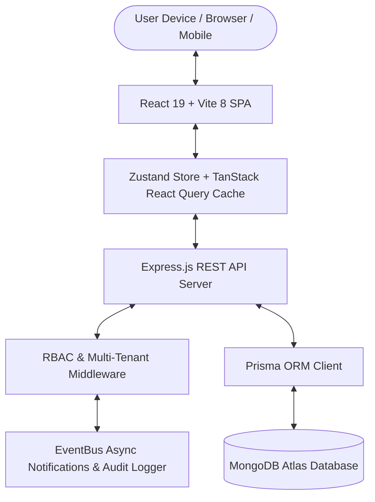
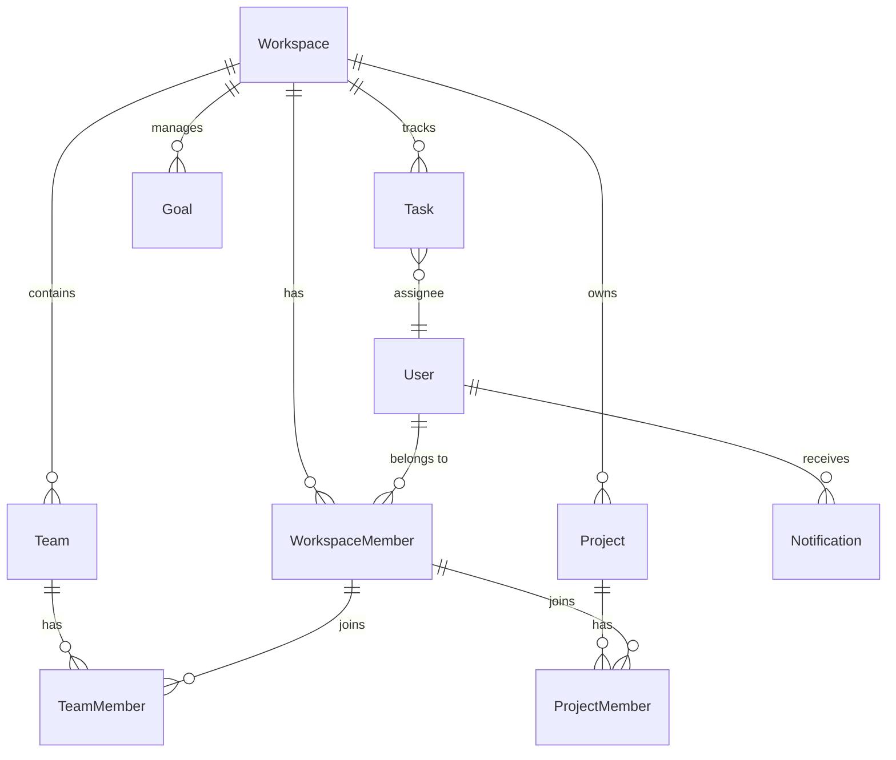

# Jira Clone — Fullstack Agile Project Management Platform

[](https://react.dev/)
[](https://vitejs.dev/)
[](https://expressjs.com/)
[](https://nodejs.org/)
[](https://www.mongodb.com/)
[](https://www.prisma.io/)
[](LICENSE)

A high-performance, full-stack agile project management platform inspired by Atlassian Jira and Linear. Features real-time multi-tenant workspace isolation, Role-Based Access Control (RBAC), interactive Kanban boards, sprint roadmaps, custom teams directory, OKR goal tracking, and a production-inspired theme architecture.

---

## 🌐 Live Demo & Deployment Links

- **Live Application (Frontend & API)**: [https://jira-clone-six-tau.vercel.app](https://jira-clone-six-tau.vercel.app)
- **REST API Base Endpoint**: [https://jira-clone-six-tau.vercel.app/api](https://jira-clone-six-tau.vercel.app/api)

---

## 📸 Screenshots & Visual Walkthrough

| **Interactive Kanban Board** | **Multi-Tenant Workspace Members** |
| :---: | :---: |
| *(Kanban board with drag-and-drop & task filters)* | *(Workspace members directory with task transfer dialog)* |

| **Roadmap & Gantt Planning** | **Dark, Light & System Appearance** |
| :---: | :---: |
| *(Visual timeline planner with epic progress spans)* | *(Multi-palette theme switcher with zero FOUC)* |

---

## ✅ Feature Checklist

- ✅ **Authentication**: Email/Password + Cryptographic Google OAuth 2.0 Sign-In + OTP Password Resets
- ✅ **Multi-Tenancy**: Strict Workspace Data Isolation (`workspaceId` boundary queries)
- ✅ **Role-Based Access Control (RBAC)**: Centralized Middleware (`OWNER`, `ADMIN`, `MEMBER`, `GUEST`)
- ✅ **Kanban Board**: Drag-and-Drop Columns, Priority Filters, Real-Time Search
- ✅ **Sprint Roadmaps**: Visual Gantt Timeline Planner mapping development Epics
- ✅ **OKRs & Goals**: Objectives tracker with progress indicators and status badges
- ✅ **Teams Management**: Custom team directory with task assignment & workload tracking
- ✅ **Invitations System**: Transactional email invitations with cryptographic token validation
- ✅ **Audit Logs**: Chronological event feed tracking administrative & role changes
- ✅ **Notifications Feed**: In-app notifications scoped strictly by active workspace
- ✅ **Theme System**: 4 Color Palettes + **Light**, **Dark**, and **System** mode auto-detection
- ✅ **Cross-Tab Sync**: Instant zero-latency theme mirroring using `BroadcastChannel`
- ✅ **Mobile Responsive**: Dynamic Viewport Height (`100dvh`), `visualViewport` soft-keyboard adaptation, and 44px touch targets

---

## 🏗️ System Architecture



---

## 🗄️ Database Entity-Relationship Diagram (ERD)



---

## 🎨 Theme System & Mobile Architecture

The application implements a production-inspired theme management system powered by React Context (`ThemeProvider`), custom CSS variables, and browser APIs:

1. **Appearance Modes & OS Detection**: Supports `Light`, `Dark`, and `System` modes. In `System` mode, the app monitors `window.matchMedia('(prefers-color-scheme: dark)')` to reactively adapt to OS theme changes.
2. **Zero FOUC (Flash of Un-themed Content)**: An inline blocking script in `index.html` evaluates theme settings before React mounts.
3. **4 Color Palettes**: `Atlassian Blue`, `Emerald Forest`, `Cyberpunk Neon`, and `Sunset Amber`.
4. **Cross-Tab Sync**: Utilizes `BroadcastChannel("jira_theme_channel")` combined with `storage` events to mirror changes across tabs instantly.
5. **Mobile Responsiveness**:
   - Dynamic Viewport Height (`100dvh` / `min-h-dvh`) prevents address bar jumping.
   - `window.visualViewport` listener adapts layout during mobile soft keyboard opening.
   - Safe-area insets (`pt-safe`, `pb-safe`) for notch and Dynamic Island support.
   - 44px x 44px minimum touch targets (`touch-target`).

---

## 🔒 Security Architecture

Implements security measures against common web vulnerabilities:
- **Google SSO Cryptographic Verification**: Google tokens validated via Google API endpoints to prevent token-forging exploits.
- **Strict Rate Limiting**: In-memory IP request monitoring limiting authentication routes to **10 requests per 15 minutes**.
- **IDOR Prevention**: Profile edits read user identities directly from verified JWT payloads (`req.user.email`).
- **Database Boundary Scoping**: All Prisma database queries are strictly scoped by `workspaceId` to prevent cross-tenant data leaks.

---

## 📑 REST API Documentation Summary

| Method | Endpoint | Access | Description |
| :--- | :--- | :--- | :--- |
| `POST` | `/api/auth/register` | Public | Register a new user account |
| `POST` | `/api/auth/login` | Public | Authenticate user & receive JWT token |
| `POST` | `/api/auth/google-login` | Public | Verify Google OAuth token & authenticate |
| `GET` | `/api/workspaces` | Private | List all workspaces for the authenticated user |
| `POST` | `/api/workspaces` | Private | Create a new workspace & assign `OWNER` role |
| `GET` | `/api/workspaces/:id/members` | Private (RBAC) | Get workspace member directory |
| `POST` | `/api/workspaces/:id/invitations` | Admin / Lead | Invite a new user to workspace via email |
| `GET` | `/api/tasks` | Private | Get all tasks scoped to the active workspace |
| `POST` | `/api/tasks` | Private | Create a new task in active workspace |
| `PATCH` | `/api/tasks/:id/status` | Private | Update task column status (To Do, In Progress, Done) |
| `GET` | `/api/teams` | Private | List teams within active workspace |
| `POST` | `/api/teams` | Admin / Lead | Create a new team within workspace |

---

## 📂 Repository Folder Structure

```text
Jira-Clone/
├── README.md                           # Master documentation
├── backend/                            # Node.js + Express.js REST API Server
│   ├── config/                         # DB connection, logger, and event bus
│   ├── controllers/                    # Express route handler logic
│   │   ├── authController.js           # Authentication & Google OAuth
│   │   ├── taskController.js           # Task management CRUD & filters
│   │   ├── teamController.js           # Teams creation & management
│   │   ├── workspaceController.js       # Multi-tenant workspace handling
│   │   └── workspaceMemberController.js # RBAC roles, invites, task transfers
│   ├── middleware/                     # Auth validation, RBAC, and rate limiting
│   ├── prisma/                         # Database Schema & MongoDB indexes
│   │   └── schema.prisma               # Prisma data models & composite indexes
│   ├── routes/                         # Express API route mapping
│   └── tests/                          # Vitest backend integration test suite
└── frontend/                           # React 19 + Vite 8 Web Client
    ├── src/
    │   ├── components/                 # Core page views (Dashboard, Auth, Navbar)
    │   ├── features/                   # Modular feature directories
    │   │   ├── audit/                  # Audit timeline log components
    │   │   ├── invitations/            # Team invite wizard modals
    │   │   ├── members/                # User profile sliding drawers
    │   │   ├── teams/                  # Detailed team overview & settings tabs
    │   │   └── workspace/              # Workspace member tables & filters
    │   ├── hooks/                      # Custom hooks (useTheme, useTasks, useUsers)
    │   ├── providers/                  # React Context Providers (ThemeProvider)
    │   ├── store/                      # Zustand global state (authStore, uiStore)
    │   ├── index.css                   # Tailwind CSS v4 directives & theme tokens
    │   └── App.jsx                     # Top-level routing & layout wrappers
    ├── index.html                      # HTML entry & pre-boot theme script
    └── vite.config.js                  # Vite build options & path alias config
```

---

## ⚡ Getting Started

### 1. Environment Configuration

Copy environment template files:
- **Backend**: `backend/.env.example` -> `backend/.env`
- **Frontend**: `frontend/.env.example` -> `frontend/.env`

Example `backend/.env`:
```env
PORT=5000
DATABASE_URL="mongodb+srv://<username>:<password>@cluster.mongodb.net/jira_clone"
JWT_SECRET="your_secure_jwt_secret_key"
```

### 2. Run Backend API
```bash
cd backend
npm install
npm run dev
```
*Backend server starts at `http://localhost:5000`.*

### 3. Run Frontend App
```bash
cd frontend
npm install
npm run dev
```
*Frontend application starts at `http://localhost:5173`.*

---

## 📊 Performance Targets & Lighthouse Metrics

Designed with accessibility best practices and performance optimizations:

| Metric | Target Score | Optimization Strategy |
| :--- | :--- | :--- |
| **Performance** | `≥ 95` | Vite code-splitting, lazy-loaded page bundles, preconnected API domains |
| **Accessibility** | `100` | Keyboard navigation, focus-visible indicators, ARIA labels, WCAG contrast |
| **Best Practices** | `100` | Secure HTTPS headers, clean dependency tree, zero console warnings |
| **SEO** | `100` | Semantic HTML5 structure, descriptive meta tags, fast LCP times |

---

## 🚀 Deployment Guide

- **Frontend**: Hosted on **Vercel** with single-page application rewriting.
- **Backend**: Hosted on **Render** as a Node.js web service.
- **Database**: Hosted on **MongoDB Atlas** with automated index syncing.

---

## 🔮 Future Improvements & Roadmap

- 🔄 **Real-Time Collaboration**: Websocket integration using Socket.io for live cursor & board updates.
- 📝 **Markdown Editor**: Rich text and markdown support for task descriptions and comments.
- 📊 **Advanced Analytics**: Velocity charts, burndown metrics, and sprint retrospective reports.
- 📦 **File Uploads**: Cloudinary / S3 integration for task attachments and media uploads.

---

## 🤝 Contribution Guidelines

Contributions are welcome!
1. Fork the repository.
2. Create a feature branch: `git checkout -b feature/amazing-feature`.
3. Commit your changes: `git commit -m 'Add amazing feature'`.
4. Push to the branch: `git push origin feature/amazing-feature`.
5. Open a Pull Request.

---

## 📜 License & Credits

- **License**: Released under the [MIT License](LICENSE).
- **Credits**: Designed and built for educational purposes, inspired by Jira (Atlassian) and Linear.
