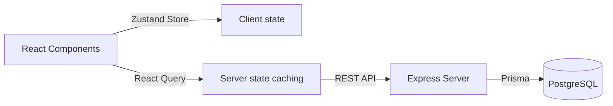

# 02 — System Architecture

### Architectural Patterns
We use a decoupled client-server Single Page Application (SPA) architecture:
* **UI Client Layer**: React 19 client compiled with Vite 8.
* **Middle-tier Guard Layer**: Custom rate limiting & auth verifications.
* **REST API Layer**: Modular routing controllers in Express.
* **Persistence Layer**: Relational PostgreSQL database handled via Prisma Client ORM.

### Component-to-Service flow diagram

